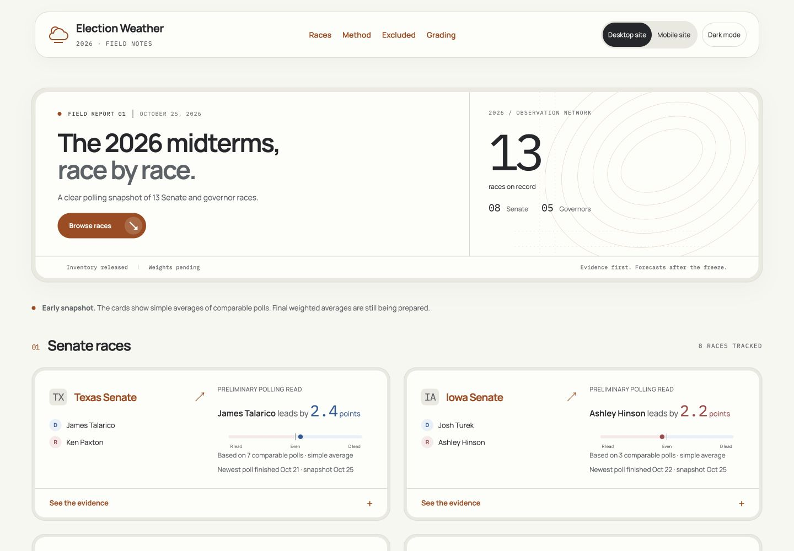

# Election Weather

A static research tracker for thirteen 2026 Senate and governor races, with traceable poll-weighting evidence and a separate record of campaign rhetoric.

It serves readers who want to inspect the sources and assumptions behind a polling comparison. Missing evidence is visible. Descriptive recall-vote differences are not causal estimates, debate heat is not vote choice, and the published win probabilities are preliminary until the November 2 freeze writes predictions.csv, the record that is graded.



## Stack

Next.js 16.4.3, TypeScript, Tailwind 4, OpenNext Cloudflare 1.20.13, Wrangler 4.152.0, Vitest. Exact versions and transitive dependencies are locked in package-lock.json. Node 24. Separate desktop and mobile compositions share the frozen data and copy; the visible switch remembers the reader’s choice. Manrope and IBM Plex Mono are served locally.

## Run

```sh
npm ci
sh scripts/sync-bundle.sh <release_id>
npm test
npm run build:cloudflare
npm run preview
```

Preview uses Wrangler on http://localhost:8788 with the production static headers. Do not use Next’s development server as the deployment verification surface.

`scripts/sync-bundle.sh` reads the named immutable release from the local vault, validates an explicit public-file allowlist and manifest hashes, then atomically replaces data/. No caches, credentials or run-state can enter the bundle. A previous copy is retained in .backups/. Data is intentionally untracked; the vault release is its canonical home. The app does not calculate analytical statistics: analysis/weight.py writes them once. Display code only sorts, rounds, labels dates and places chart coordinates.

## Build and security

All routes prerender. Next builds once; the CSP script hashes every inline script in those final HTML bytes; OpenNext runs with --skipNextBuild. The exact HTML is promoted into Workers static assets to prevent prerender-route 404s. A final verifier compares bytes and hashes again. The generated fallback Worker is replaced with a minimal static 404 responder so unknown paths cannot enter Next’s server or an unconfigured ISR cache. There are no API routes, middleware, auth, database bindings, secrets or runtime data requests. Static assets bypass the Worker with run_worker_first=false.

`public/_headers` has no duplicate header names across overlapping rules. Scripts use per-route SHA-256 authorization, never unsafe-inline or nonces. Styles and fonts are local. A security patch override keeps the build tools on patched glob and undici releases; npm audit must have no high or critical findings before publication.

## Publish and rollback

Run the production browser flow in Max’s real Chrome, check every route and the four required widths in both compositions, record one local-tab handoff in run-state, then run `npm run deploy`. This publishes only the authorized workers.dev site. Record the returned version ID and repeat live checks. GitHub push and electionweather.com binding require Max’s separate word.

For rollback, use the previously recorded Cloudflare version, revert the relevant local code commit, and sync the prior immutable release. Never modify an existing release. The current release ID, analytical cutoff and manifest SHA-256 are displayed in every footer.

## Verification and analysis

```sh
npm test
npm run typecheck
npm audit
python3 -m unittest discover -s tests -p 'test_*.py'
python3 analysis/weight.py --self-test
```

The bundle tests reject tampering, unknown schema versions, mixed release identity, extra files and malformed CSV, including multiline data. The method page renders the release-frozen method note with its limitations and Deferred section. Excluded is the only page displaying quarantined poll estimates. Grading records the prospective contract and remains empty until the relevant freeze and certified-result gates pass.

## Visual direction

The consumer hierarchy combines the quick card scan and strong numerical hierarchy observed on [Kalshi](https://kalshi.com/) with the explanatory polling approach in [538’s guide to reading polls](https://www-cdn.abcnews.com/538/read-political-polls-2024/story?id=113560546). The reference is presentation only. Election Weather’s values remain its own calculator outputs, in polling-margin points. Interface Design, Taste, High-End Visual Design and Data Visualization Creator guided the implementation.
